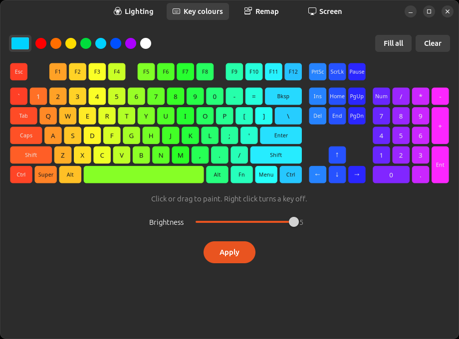
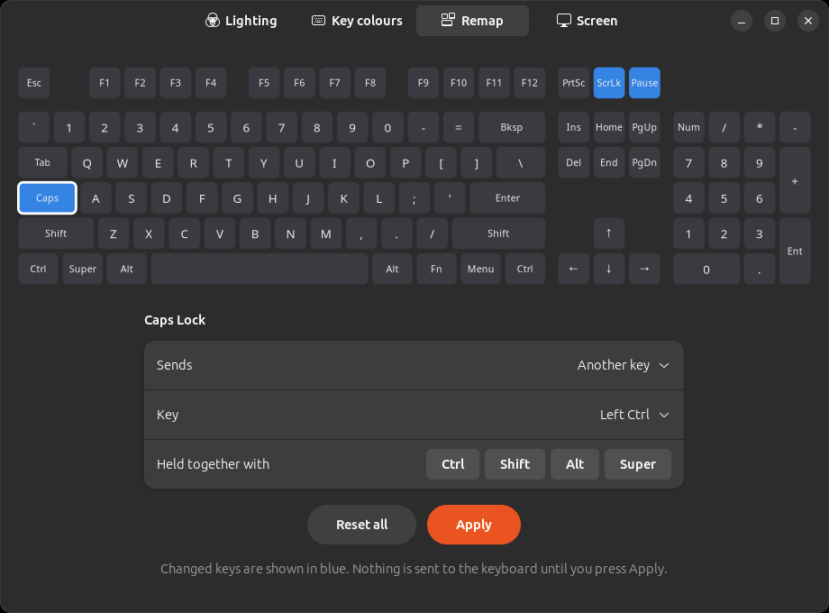

# aula-f108-gui

Configure the Aula F108 Pro keyboard on Linux. The official software only runs
on Windows.

There is a small GTK app and a command line tool. Still a work in progress.



| Lighting | Remap |
| --- | --- |
|  |  |

## What it can do

- switch between the 20 built-in backlight effects and set colour, brightness,
  speed and direction
- paint individual keys in any colour
- remap keys to other keys, shortcuts like Ctrl+Shift+C, media controls or
  mouse buttons
- set the clock on the keyboard's screen

## Requirements

- Python 3.10 or newer
- GTK 4.10+ and libadwaita 1.4+ with their Python bindings for the app. On
  Ubuntu: `sudo apt install python3-gi gir1.2-gtk-4.0 gir1.2-adw-1`. The
  command line tool needs nothing besides Python.
- the keyboard connected with the USB cable and switched to USB mode. Settings
  can't be written over the 2.4G receiver or Bluetooth, but once written they
  stay on the keyboard and keep working wirelessly.

## Install

### Debian / Ubuntu package

Build the package and install it:

```
./packaging/build-deb.sh
sudo apt install ./dist/aula-f108_0.1.1_all.deb
```

That pulls in the GTK bits, sets up the udev rule and adds the app to the
menu. The command is `aula-f108`: on its own it opens the app, with arguments
it's the command line tool. Remove it again with `sudo apt remove aula-f108`.

### From the checkout

Install the udev rule so the keyboard can be reached without root, then unplug
and replug the cable:

```
sudo cp udev/70-aula-f108.rules /etc/udev/rules.d/
sudo udevadm control --reload
```

To get an entry in the app menu (optional, per user, no root needed):

```
./install.sh
```

`./install.sh --remove` takes it out again.

## Usage

The examples below run from the checkout. With the package installed, use
`aula-f108` in place of `python3 -m aula_f108`. Without arguments the app
opens:

```
python3 -m aula_f108
```

With arguments it works as a command line tool:

```
python3 -m aula_f108 status
python3 -m aula_f108 light breath --color ff0080 --brightness 4
python3 -m aula_f108 light rolling --rainbow --speed 2
python3 -m aula_f108 light off
python3 -m aula_f108 paint w=00ff00 a=00ff00 s=00ff00 d=00ff00 --all 202020
python3 -m aula_f108 remap capslock=lctrl pause=media:play
python3 -m aula_f108 remap --reset
python3 -m aula_f108 clock
```

`--dry-run` prints the packets instead of sending them.

## Tested on

Ubuntu 24.04 with one keyboard (USB id `0c45:800a`). It should work on other
distributions that have recent enough GTK and libadwaita, but I haven't tried
them. Ubuntu 22.04 ships versions that are too old for the app; the command
line tool still works there.

## Good to know

- The keyboard can't be asked for its current settings, it only accepts new
  ones.
- Remapping always sends the whole table, so `remap` replaces whatever was
  set before. `remap --reset` puts every key back to normal, which is handy
  if a remap goes wrong.
- Only the normal layer can be remapped for now, not the Fn layer. The Fn key
  itself is left alone on purpose.
- The light bar above the arrow keys and the side lights aren't reachable from
  software. Use the Fn shortcuts from the manual for those.

## Tests

```
python3 -m pytest
```

## Credits

The protocol was worked out by Parsia Hakimian in
[parsiya/f108-pro](https://github.com/parsiya/f108-pro). This project
reimplements the parts it needs in Python based on those notes.

## License

MIT
