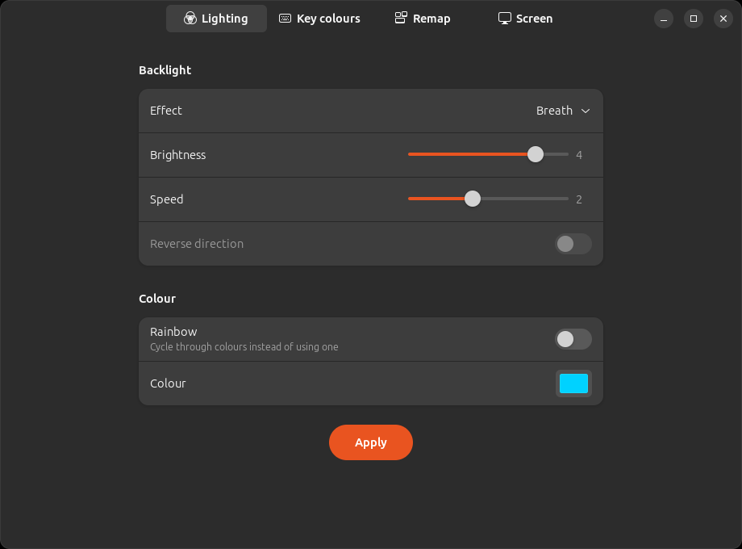
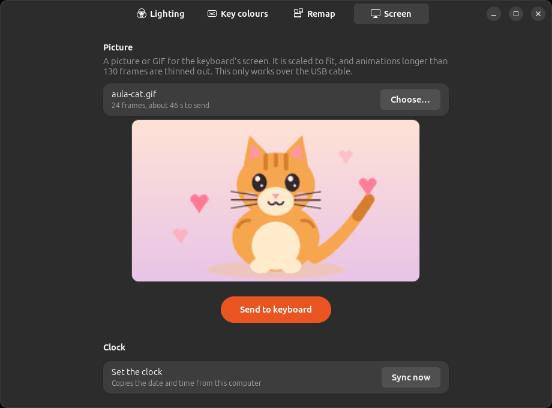

# aula-f108-gui

Configure the Aula F108 Pro keyboard on Linux. The official software only runs
on Windows.


| Lighting | Remap | Screen |
| --- | --- | --- |
|  |  |  |

## What it can do

- switch between the 20 built-in backlight effects and set colour, brightness,
  speed and direction
- configure per key RGB
- remap keys to other keys, shortcuts like Ctrl+Shift+C, media controls or
  mouse buttons
- set the clock on the keyboard's screen
- put your own picture or GIF on the screen

## Requirements

- Python 3.10 or newer
- GTK 4.10+ and libadwaita 1.4+ with their Python bindings for the app. On
  Ubuntu: `sudo apt install python3-gi gir1.2-gtk-4.0 gir1.2-adw-1`. The
  command line tool needs nothing besides Python.
- Pillow (`python3-pil`), only for pictures on the screen
- the keyboard connected with the USB cable (in USB mode) or through its
  2.4G receiver. The app works out which one it is. Bluetooth isn't
  supported. Settings are stored on the keyboard, so its persistent.

## Install

### Debian / Ubuntu package

Build the package and install it:

```
./packaging/build-deb.sh
sudo apt install ./dist/aula-f108_0.3.1_all.deb
```

That pulls in the GTK bits, sets up the udev rule and adds the app to the
menu. The command is `aula-f108`: on its own it opens the app, with arguments
it's the command line tool. Remove it again with `sudo apt remove aula-f108`.

### From the checkout

Install the udev rule so the keyboard can be reached without root, then unplug
and replug the cable or the receiver:

```
sudo cp udev/72-aula-f108.rules /etc/udev/rules.d/
sudo udevadm control --reload
```

To get an entry in the app menu (optional, per user, no root needed):

```
./install.sh
```

`./install.sh --remove` takes it out again.

## Usage

The examples below run from the checkout. With the package installed, use
`aula-f108` in place of `python3 -m aula_f108`. Without arguments the app
opens:

```
python3 -m aula_f108
```

With arguments it works as a command line tool:

```
python3 -m aula_f108 status
python3 -m aula_f108 light breath --color ff0080 --brightness 4
python3 -m aula_f108 light rolling --rainbow --speed 2
python3 -m aula_f108 light off
python3 -m aula_f108 paint w=00ff00 a=00ff00 s=00ff00 d=00ff00 --all 202020
python3 -m aula_f108 remap capslock=lctrl pause=media:play
python3 -m aula_f108 remap --reset
python3 -m aula_f108 clock
python3 -m aula_f108 image cat.gif
```

`--dry-run` prints the packets instead of sending them.

## Pictures on the screen

Any picture or GIF can go on the screen. It is scaled and cropped to 240x135.
This only works over the cable, and bigger animations take a while to send
(a second or so per five frames).

There is one way to do real damage here, so the limits are fixed in the code:

- The keyboard stores the animation in a slot that holds 141 frames, and it
  doesn't check what it is sent. Anything beyond the slot overwrites the
  graphics of the built-in menus, and nobody has found a way to get those
  back. This program never sends more than 130 frames. Longer animations
  are thinned out, keeping their running time.
- Sending stops at the first page the keyboard doesn't confirm.

Frame times are stored in 2 ms steps up to about half a second, so a GIF with
longer pauses plays those a bit faster than intended.

I have tried this on one keyboard, with stills and short animations. Treat
it as experimental like the receiver support.

## Over the 2.4G receiver (experimental)

Everything except pictures for the screen also works through the receiver,
without the cable, and in
that mode the app shows the keyboard's battery level too. The receiver uses a
different protocol from the cable. I worked it out from the vendor's Windows
software and have only tried it on my own keyboard, so:

- now and then a packet gets lost on the way. The app sends it again, but if
  a change doesn't show up, apply it once more.
- the receiver answers for itself, so the app can't always tell whether the
  keyboard really took a change.
- if something misbehaves, the cable is the dependable route.

## Tested on

Ubuntu 24.04 with one keyboard (USB id `0c45:800a`). It should work on other
distributions that have recent enough GTK and libadwaita, but I haven't tried
them. Ubuntu 22.04 ships versions that are too old for the app; the command
line tool still works there.

## Good to know

- The keyboard can't be asked for its current settings, it only accepts new
  ones. The app shows what it last sent.
- Remapping always sends the whole table, so `remap` replaces whatever was
  set before. `remap --reset` puts every key back to normal, which is handy
  if a remap goes wrong.
- Only the normal layer can be remapped for now, not the Fn layer. The Fn key
  itself is left alone on purpose.
- On the cable the keyboard has the same USB id as a camera in the
  libgphoto2 list, and the system opens cameras to whoever is logged in. That
  includes the interfaces that carry what you type. The udev rule here takes
  that access back and leaves only the two interfaces the app needs. It
  counts from the next time the keyboard is plugged in.
- The light bar above the arrow keys and the side lights aren't reachable from
  software. Use the Fn shortcuts from the manual for those.

## Tests

```
python3 -m pytest
```

## Credits

The cable protocol was worked out by Parsia Hakimian in
[parsiya/f108-pro](https://github.com/parsiya/f108-pro).

## License

MIT
